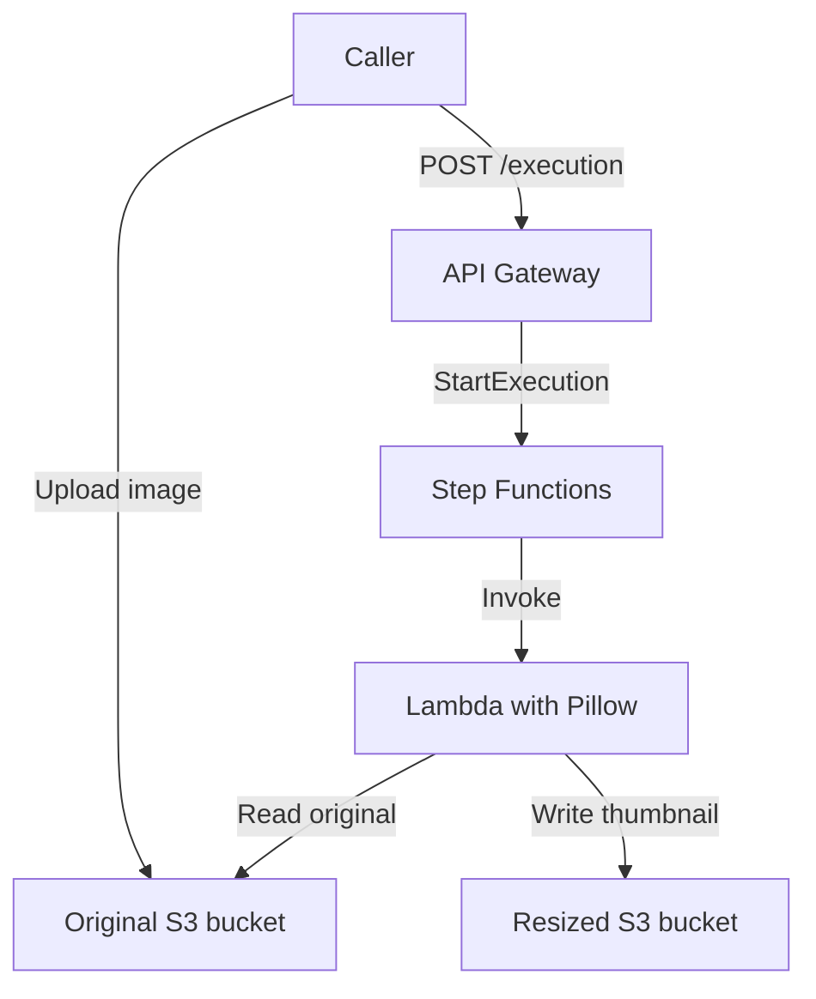

# Serverless Image Processing Pipeline

## Project Overview

This project uses AWS services to create a thumbnail from an image. The caller uploads an original image to Amazon S3 and sends a POST request to API Gateway. API Gateway starts a Step Functions workflow, which invokes a Lambda function. The Lambda function resizes the image with Pillow and saves the result to a second S3 bucket.

Uploading an image to S3 does not start the workflow automatically. After uploading, the caller must send a POST request to the API Gateway endpoint.

## Architecture



## AWS Resources

| Resource | Name or value |
|---|---|
| AWS Region | `us-east-1` (US East, N. Virginia) |
| Original image bucket | `image-capstone-original-harper-2026` |
| Resized image bucket | `image-capstone-resized-harper-2026` |
| Lambda function | `resize-image-capstone-lambda` |
| Lambda runtime | Python 3.13 |
| Lambda architecture | x86_64 |
| Pillow layer | `pillow-python313`, version 1 |
| Step Functions state machine | `image-resize-workflow` |
| State machine ARN | `arn:aws:states:us-east-1:513002790945:stateMachine:image-resize-workflow` |
| API Gateway endpoint | `https://ersk19egkg.execute-api.us-east-1.amazonaws.com/prod/execution` |
| API method | `POST` |

## Source Files

- `lambda_function.py` — Lambda image-resizing function.
- `state-machine.json` — Step Functions state machine definition.

## Image Processing Workflow

1. Upload an image to the original S3 bucket.
2. Send a POST request to the API Gateway endpoint with the source bucket and image key.
3. API Gateway calls the Step Functions `StartExecution` action.
4. Step Functions invokes the Lambda function.
5. Lambda reads the image, creates a thumbnail with Pillow, and writes it to the resized bucket under `thumbnails/`.
6. The state machine checks the Lambda result and finishes with either a success or failure state.

The Lambda function creates a thumbnail with a maximum size of 300 × 300 pixels while preserving the image’s aspect ratio.

## Prerequisites

- An AWS account with access to the `us-east-1` Region.
- The two S3 buckets listed above.
- A Python 3.13 Lambda function using the x86_64 architecture.
- The `pillow-python313` Lambda layer attached to the function.
- IAM permissions for Lambda to read from the original bucket and write to the resized bucket.
- IAM permissions for Step Functions to invoke the Lambda function.
- An API Gateway execution role with permission to start this state machine.

## Deployment Instructions

1. Create the original and resized S3 buckets listed in the AWS Resources table.
2. Create the Lambda function `resize-image-capstone-lambda` with the Python 3.13 runtime and x86_64 architecture.
3. Attach the `pillow-python313` layer to the Lambda function.
4. Set the Lambda environment variable `OUTPUT_BUCKET` to:
   `image-capstone-resized-harper-2026`
5. Upload `lambda_function.py` to the Lambda function.
6. Configure the Lambda execution role to allow:
   - `s3:GetObject` on objects in the original bucket.
   - `s3:PutObject` on objects in the resized bucket.
7. Create the Standard Step Functions state machine using `state-machine.json`.
8. Configure the Step Functions execution role to allow it to invoke `resize-image-capstone-lambda`.
9. Create a Regional API Gateway REST API with a `POST` method on `/execution`.
10. Configure the method to call the Step Functions `StartExecution` action. Its execution role must allow `states:StartExecution` on the state machine ARN shown above.
11. Deploy the API to the `prod` stage.

## Testing the API

Upload an image to the original bucket, then send a POST request to the API Gateway endpoint. Replace `sample.jpg` with the exact object key of the uploaded image. Use a different execution name for each request.

```json
{
  "input": "{\"bucket\":\"image-capstone-original-harper-2026\",\"key\":\"sample.jpg\"}",
  "name": "ReplaceWithAUniqueExecutionName",
  "stateMachineArn": "arn:aws:states:us-east-1:513002790945:stateMachine:image-resize-workflow"
}
```

A successful request returns an execution ARN. Check the execution in Step Functions; its status should be `Succeeded`. Then check the `thumbnails/` folder in the resized bucket for the generated image.

## Submission

Submit the GitHub repository link and a short video demonstrating the image upload, workflow execution, and generated thumbnail.